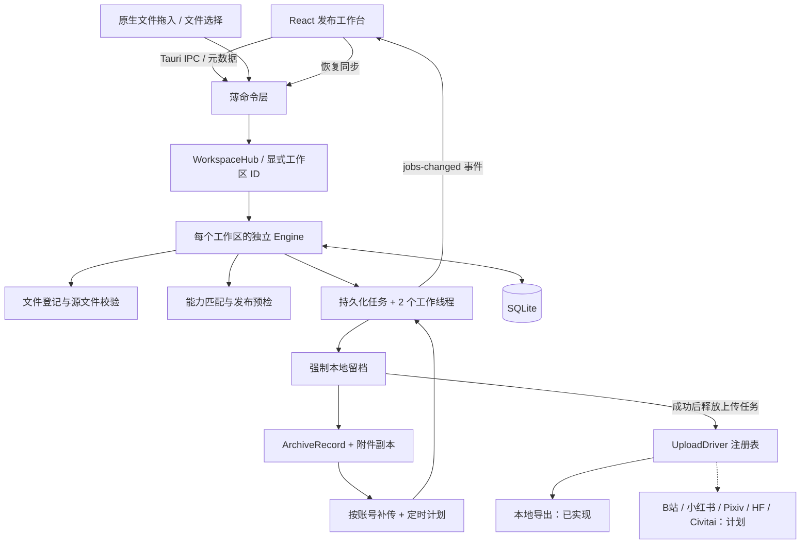
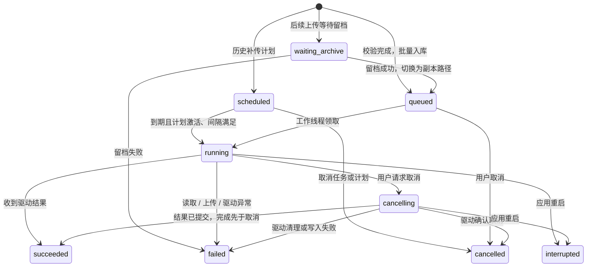

# 聚合上传框架

## 技术决策

以 CyanTools2 实际代码为参照，前端使用 React 19、TypeScript、Vite 6 和 Lucide，桌面宿主使用 Tauri 2。数据继续使用 SQLite / rusqlite。当前没有 Python 子进程或 Node 后端，业务放到独立的 Rust crate，便于测试，也允许未来在 CLI 或 HTTP 服务中复用。

Rust 能减少大文件处理的复制和内存压力，并将阻塞读写隔离出界面线程；真实上传速度仍取决于网络、平台限速和 API，不能仅凭换语言保证更快。当前本地驱动每个工作线程持有约 1 MiB 的文件缓冲，前端只接收元数据。



## 核心对象

| 对象               | 作用                                                                            |
| ------------------ | ------------------------------------------------------------------------------- |
| `Asset`            | 本地文件的稳定 ID、规范化路径、名称、类型、大小和修改时间；不把整个文件交给 JS  |
| `WorkspaceProfile` | 工作区 ID、名称、内容分类、启用插件及账号勾选；存于该区数据库 |
| `Draft`            | 可编辑标题、正文、附件 ID；未保存修改只存在内存中                               |
| `Publication`      | 提交时固定下来的标题、正文、附件元数据快照；后续修改草稿不改动已排队任务        |
| `DriverDescriptor` | 平台声明：支持的类型、标题 / 正文能力、附件数量和大小限制、接入状态             |
| `Validation`       | 一个目标是否可用及不可用原因；最终以 Rust 检查为准                              |
| `ArchiveRecord`    | 已成功留档的内容与附件副本路径、校验值；与平台任务解耦 |
| `UploadTarget`     | 驱动 ID、账号标识和独立目标 ID；目前不包含真实平台凭证 |
| `ReplayPlan`       | 目标账号、归档列表、开始时间、间隔、状态和下次允许派发时间 |
| `Job`              | 一次留档或一次发往指定账号的上传；包含归档引用、依赖、计划、进度和结果 |
| `Receipt`          | 当前保存目的地位置、附件输出记录及校验值；远端驱动接入时应扩展远端作品 ID / URL |

图片、视频、文本文件、模型和其他附件属于 `AssetKind`。标题和正文属于发布的元信息，不要求用户创建临时文件。一个混合发布必须整体符合目标能力，不能静默丢掉平台不支持的附件。当前模型按扩展名初分 AI 权重和三维模型；平台驱动必须进一步区分模型子类型及允许的格式。

## 执行与恢复

`WorkspaceHub` 管理根目录索引和每区的独立 `Engine`。默认区继续使用旧数据根目录；新增区使用 `workspaces/<UUID>/`，各有数据库、文件副本、进程锁和两个工作线程。主程序启动全部已登记工作区，切换只改变当前界面及持久化的上次选择，不终止后台任务。

所有文件、草稿、账号、任务、补传 IPC 请求显式携带 `workspaceId`；命令先查找对应引擎，再调用操作。界面使用绑定固定 ID 的客户端，切换时先保存草稿与账号选择，并丢弃旧工作区迟到的刷新结果。新空间不复制其他区资料。每个引擎在提交、补传、重试和创建账号时检查启用插件；工作区设置与提交使用同一提交锁，停用仍有活动上传任务的插件会被拒绝。

索引数据库 `workspaces.sqlite3` 为 schema v1，各区业务数据库维持 schema v2，工作区配置存入 `settings.workspace`。新安装插件不会自动扩大已有工作区的插件范围。工作区目录只使用生成的 UUID，名称不参与路径拼接。完整使用及备份约束见 [工作区说明](workspaces.md)。



- 所有目标先验证，再在一个 SQLite 事务中创建一个强制留档任务和各账号的 `waiting_archive` 上传任务；目标为空时仅留档。
- 留档完成后，归档索引、父任务成功和依赖任务的释放在同一事务提交。后续上传一律读取归档副本，先核验 SHA-256。
- 两个工作线程从数据库领取到期任务，没有仅存在内存的待执行队列；慢文件不阻塞 WebView，驱动失败不会使整个应用退出。
- 领取补传任务时，原子更新该计划的 `nextReleaseAt = 实际领取时间 + 间隔`。重启或恢复暂停后不会因全部逾期而突发派发；间隔 0 可并发连续执行。时间是开始派发的间隔，不是完成时间保证。
- 历史补传按归档时间排序，按 `archiveId + targetId` 检查成功和活动任务；显式 `force` 只绕过成功记录，不绕过正在排队的任务。提交锁串行化补传 / 重试创建，并重新计算预览。
- 进度回调在本地驱动内按约 120ms 节流，事件用于提示界面刷新；前端每两秒补查，窗口隐藏时暂停轮询。
- 取消是协作式；排队任务直接取消，运行任务由驱动检查令牌。结果已提交后到达的取消无法撤回已经完成的写入。
- 重试会创建新任务并关联 `retryOf`，保留之前结果，不覆写原尝试。当前只支持重新开始，不支持分片续传。
- 启动时保留新版 `queued` / `scheduled` 任务及计划状态；`running` / `cancelling` 标记为 `interrupted`，由用户核对后重试。无法完成的前置归档会阻止后续上传。旧版活动任务仍标记中断。
- 本地归档先写 `.partial-<UUID>`，最后写清单、同步文件并重命名到 `<UUID>`。取消和普通错误会清理本次临时目录；进程被强制结束时可能残留 `.partial-*`，不得当作成功结果。
- 关闭即退出，目前没有托盘常驻、系统定时任务或唤醒。数据目录由操作系统文件锁独占，第二个实例返回 `workspace_busy`；锁随进程结束释放。
- 数据库 schema v2 增加 `archives`、`targets` 和 `replay_plans`。旧版已成功本地归档迁移为历史记录，保留原副本路径；缺失旧副本由补传检查报告。

导入时仅登记源文件，正式发布后先流式复制到归档，再上传。入队与复制前后核对大小和毫秒修改时间，SHA-256 记录实际读取的数据；首次归档仍无法保证检测刻意保留大小与时间的并发源文件修改。归档完成后的补传则与保存的校验值对照，内容变化会被拒绝。进程在目录重命名与数据库提交之间崩溃，可能留下未索引的输出目录；当前不自动清理或推定成功。

## 驱动扩展

默认扫描 `plugins/` 的一级子目录，各目录用 `plugin.json` 声明能力、版本、状态和统一入口。外部插件是独立进程，使用版本化 JSON Lines 协议；内置 `local-archive` 仍编译在核心中，通过相同 `UploadDriver` 接口调用。新增外部插件无需修改 Rust 注册列表或重新编译主程序，重启后发现。

实现 `crates/upload-core/src/drivers/mod.rs` 中的 `UploadDriver`：

```rust,ignore
pub trait UploadDriver: Send + Sync {
    fn id(&self) -> &str;
    fn validate(&self, publication: &Publication) -> Vec<String>;
    fn upload(&self, publication: &Publication, context: &UploadContext<'_>) -> Result<Receipt>;
}
```

新增驱动流程：

1. 用 `npm run plugin:new -- my-platform "我的平台"` 从 `plugins/template` 创建目录，自动同步清单、入口 ID 和 Cargo 包名。
2. 实现 `validate` / `upload`，在 `main` 调用 SDK 的 `run_plugin(YourPlugin)`。平台专用能力检查和远端请求全部放在插件中。
3. 在本插件的 `plugin.json` 声明能力。真实平台尚未实现时使用 `planned`；外部进程入口默认 `plugin.exe --upload-hub-plugin`。
4. 运行该目录的 `build-plugin.ps1` 生成入口可执行文件，启用后重启主程序。目录缺失、清单错误、重复 ID 或入口不可用均显示独立诊断。
5. 使用流式请求和必要的网络超时；通过统一进度消息反馈字节数，成功回执必须对应真正完成的上传。主程序处理进程超时和取消，不以“已启动进程”作为成功依据。
6. 为真实平台加入独立账号的集成测试，明确最终提交、幂等和失败重试语义。进程异常或取消可能留下远端已提交结果，不能自动假定可撤回。
7. 默认账号目标在各工作区发现插件时创建；用户在该工作区启用插件后才可使用。历史补传通过同一个入口传入该区的归档与账号，不需要再次导入旧文件。

`UploadContext` 包含账号目标、任务 ID、进度回调、取消令牌、本地输出根目录，以及可选的 `PluginWorkspace`：工作区 ID、名称、分类和专用插件数据目录。强制留档直接调用本地归档实现；本地导出按各区 `deliveries/<targetId>` 隔离。插件账号配置应存入 `workspace.dataDir/<targetId>`，不能仅按可能在不同工作区重复的默认账号 ID 存到全局插件目录。凭证不进入历史快照。不要把平台分支放进通用队列或 React 上传按钮。

外部进程的 stdin 只接收一个请求，stdout 只接收协议消息，stderr 限量收集诊断。主程序异步读写管道、限制消息大小、校验进度与最终响应、等待成功退出，并在超时或取消时终止进程。Windows 以 `CREATE_NO_WINDOW` 启动。进程协议提供隔离和生命周期管理，不是权限沙箱；插件与主程序使用同一用户权限。完整协议、字段和开发步骤见 [插件说明](../plugins/README.md)。

## 首批平台与接入顺序

平台范围按需求预留：

| 平台         | 初期设计目标                 | 接入时需确认                                        |
| ------------ | ---------------------------- | --------------------------------------------------- |
| B站          | 视频、封面、标题、简介       | 可用投稿接口、账号权限、分区、分P、审核回执         |
| 小红书       | 图文 / 视频笔记              | 可用授权方式、图文与视频的独立校验、话题与封面      |
| Pixiv        | 插画、标题、说明             | 可用投稿方式、标签、多图、作品属性                  |
| Hugging Face | 模型文件、模型说明、仓库提交 | 官方 Hub API、仓库身份、分片 / 大文件上传、提交回执 |
| Civitai      | 模型版本、示例图、说明       | 可用上传 / 发布接口、版本属性、底模与文件信息       |

本表是本产品的目标范围，不代表平台已开放对应接口。开发实际驱动时逐一查阅官方文档和账户权限，不把读取接口视作上传接口，也不在通用层依赖页面选择器。

下一阶段建议先补齐以下通用能力，再选择一个真实平台做完整闭环：

1. 扩展 `UploadTarget`：真实账号身份、连接状态和凭证引用；密钥放系统凭证库，日志和任务快照不携带 token / cookie。
2. 平台专用字段：标题 / 正文覆盖、分区、标签、可见性、仓库和模型版本；使用版本化 schema 生成表单。
3. `prepare → upload assets → finalize → verify` 阶段和平台幂等键；失败时保存远端上传会话，区分可重试错误与需要重新授权。
4. 平台级并发 / 速率限制、超时、重试退避；分片续传必须由平台驱动明确实现。
5. 分页历史、媒体预览、跨路径归档搬迁与导入；当前历史及调度数据全量读取，适合框架阶段，尚未针对大量历史优化索引。

## IPC 与权限

| 命令             | 说明                                 |
| ---------------- | ------------------------------------ |
| `bootstrap`      | 读取驱动、草稿、附件、任务、历史、账号、计划和路径 |
| `create_workspace` | 创建独立工作区并切换，初始账号勾选为空 |
| `switch_workspace` | 保存上次选择并返回所选区快照 |
| `update_workspace` | 修改该区名称、内容分类和插件范围 |
| `select_targets` | 保存该区的账号勾选 |
| `import_files`   | 接收路径并登记文件，逐个返回错误     |
| `save_draft`     | 保存草稿，不执行上传                 |
| `preflight`      | 检查源文件及各平台能力               |
| `enqueue_upload` | 校验后创建强制留档与各账号依赖任务   |
| `list_jobs`      | 查询任务快照                         |
| `cancel_job`     | 请求取消指定任务                     |
| `retry_job`      | 按旧快照创建新的尝试                 |
| `list_history`   | 读取归档、账号目标和补传计划 |
| `create_target`  | 创建同平台内名称唯一的账号标识 |
| `preview_replay` | 检查归档兼容性、历史记录与计划时间 |
| `schedule_replay` | 再检查后原子创建计划和待执行任务 |
| `set_plan_status` | 暂停、继续或取消补传计划 |

`bootstrap` 可不传工作区 ID 以恢复上次选择；`create_workspace` 接收配置，其余操作显式传入工作区 ID。`bootstrap` 和工作区管理返回 `WorkspaceSnapshot`，包含当前工作区信息和工作区列表。

主窗口只授予 Tauri 核心权限与文件选择权限；CSP 禁用远端脚本、iframe 和任意对象。前端没有通用网络或凭证接口，外部插件是普通本机进程，可在自身实现中调用网络 API。文件读取发生在 Rust / 插件内，JS 不通过 base64 搬运大文件。未来即使打开平台登录窗口，也不得授予它主窗口的本地命令权限。

## 文档依据

Context7 MCP 在本次会话不可用，已使用项目现有实现和官方文档核对：

- [Tauri Rust 命令](https://v2.tauri.app/develop/calling-rust/)
- [Tauri 文件拖入事件](https://v2.tauri.app/reference/javascript/api/namespacewebview/)
- [Tauri 文件选择对话框](https://v2.tauri.app/plugin/dialog/)
- [Tauri capabilities](https://v2.tauri.app/security/capabilities/)
- [Tauri 配置](https://v2.tauri.app/reference/config/)
- [rusqlite Connection](https://docs.rs/rusqlite/latest/rusqlite/struct.Connection.html)
- [rusqlite Transaction](https://docs.rs/rusqlite/0.37.0/rusqlite/struct.Transaction.html)
- [Rust File 文件锁与时间戳](https://doc.rust-lang.org/std/fs/struct.File.html)
- [Rust Condvar](https://doc.rust-lang.org/std/sync/struct.Condvar.html)
- [Rust Command 与进程输入输出](https://doc.rust-lang.org/std/process/struct.Command.html)
- [Rust Child 生命周期](https://doc.rust-lang.org/std/process/struct.Child.html)
- [Windows CommandExt](https://doc.rust-lang.org/std/os/windows/process/trait.CommandExt.html)
- [Serde 协议字段属性](https://serde.rs/container-attrs.html)
- [React useEffect 清理与异步结果处理](https://react.dev/reference/react/useEffect)


## Pixiv 插件与提交身份

`plugins/pixiv` 是独立 Rust 可执行插件，沿用模板 `UploadDriver` + SDK 入口。配置在 `workspace.dataDir/<target.id>`，Cookie 用 Windows DPAPI 保存。宿主不把凭据写入作品、归档或任务。

协议增加可选 `operationId`：宿主沿任务 `retryOf` 链得到原始操作 ID，跨重试稳定，显式新上传 / 重发生成新 ID；旧调用缺省时 SDK 使用 `jobId`。Pixiv 用此 ID 保存提交日志，先落盘再 POST，拿到 conversion key 后继续查询，只有确认作品 ID 才返回回执。未知提交结果阻止自动再次 POST。

网页接口可能变化，当前通过模拟网络与本机流程验证，尚未实号发布。详见 [Pixiv 插件说明](../plugins/pixiv/README.md)。
